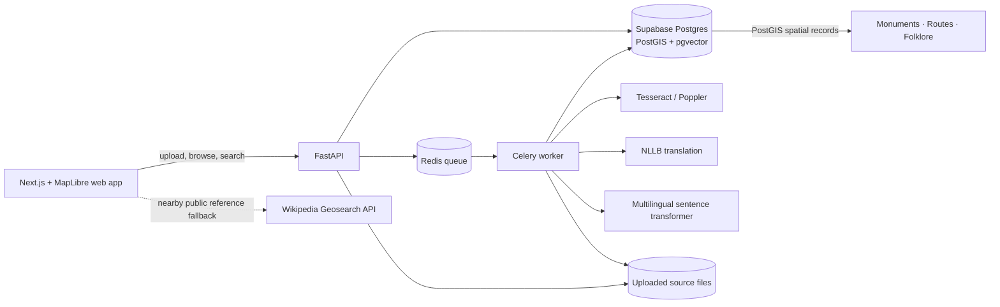

# SthalaSutra

**Heritage, connected to its place.** SthalaSutra is a searchable, map-aware archive for heritage records: scans and photographs stay linked to their OCR transcription, English translation, metadata, and geographic context.

## What works in this MVP

- Upload PDF, JPEG, PNG, or WebP files with optional place, region, and coordinates.
- Process uploads asynchronously with Celery and Redis, with exponential retries and visible queued/failed states. Tesseract OCR supports English, Hindi, and Gujarati; PDFs are rendered one page at a time and capped at 100 pages.
- Validate upload signatures and extensions, file size, location coordinates, and archive metadata before storing the original source.
- Translate Hindi and Gujarati to English with a local NLLB-200 model. Long passages are chunked so their tail is not silently discarded; English transcription is retained as-is.
- Generate multilingual 384-dimensional embeddings over text chunks and search passages with pgvector cosine similarity.
- Browse and filter by region, category, and era; view monuments, route geometries, and folklore records on a MapLibre map using OpenStreetMap tiles.
- If an archive search for `near <place>` has no matches or the archive API is offline, show clearly labeled nearby reference articles from the no-key [Wikipedia Geosearch API](https://www.mediawiki.org/wiki/API:Geosearch). Results are cached for an hour and are never inserted into the archive automatically.
- Open an archive record or nearby landmark and ask the AI heritage guide questions. It grounds answers in that record and a linked public Wikipedia article when one is available, and returns the sources used. OCR and translation uncertainty are called out; answers still need scholarly source checking.
- Inspect the source image, original transcription, and translation together.

## Architecture



The local one-command setup runs Postgres with PostGIS/pgvector, Redis, the API, worker, and frontend in Compose. Hosted setup uses Supabase Postgres for the database and deploys the Next.js frontend to Vercel. The Next.js server proxies archive requests to FastAPI through `HERITAGE_API_URL`, avoiding a hardcoded browser-side localhost URL and simplifying CORS. The API/worker remain persistent services because OCR and embedding models need a worker process and file storage.

## Repository structure

```text
frontend/                  Next.js archive, search, upload, and map UI
backend/app/               FastAPI routes, SQLAlchemy models, Celery jobs, seed script
ml/                        OCR, translation, metadata, and embedding adapters
infra/                     Compose stack and PostGIS + pgvector database image
supabase/migrations/       versioned Supabase schema migration
data/                      generated sample archive notes
scripts/demo.ps1           short video walkthrough
```

## Database schema

- `places`: heritage place name, region, and optional `geometry(Point, 4326)` point.
- `artifacts`: original file identity and storage path, category, era, language, processing state, coordinates, and optional place.
- `passages`: per-page OCR transcription, optional English translation, extracted entity JSON, and `vector(384)` embedding.
- `map_features`: typed monument/route/folklore records with PostGIS geometry and a link to a source artifact.

Indexes cover place and feature geometry (GiST), passage vectors (HNSW cosine), artifact relationships, and creation time. RLS is enabled on all four Supabase tables. A follow-up migration revokes `anon`, `authenticated`, and `service_role` table grants and future table/sequence defaults; verified on the live project. The API connects server-side with the database owner credential and never exposes it in the browser. All migrations are applied to Supabase project `SthalaSutra` (`aeqoautluushbwpyrpnc`).

## Run locally

Requirements: Docker Desktop with Compose, at least 8 GB of available memory, and a few GB of free disk for the OCR/translation/embedding model cache. The first image build and first model downloads can take several minutes.

```powershell
docker compose -f infra/docker-compose.yml up --build
docker compose -f infra/docker-compose.yml exec api python -m app.seed
```

Open http://localhost:3000. API docs are at http://localhost:8000/docs. The first OCR/search job downloads the multilingual sentence-transformer model; the first Hindi or Gujarati translation downloads NLLB-200 (about 2.5 GB). Docker keeps model downloads in a named volume across restarts. Sample pages and route/folklore map layers are synthetic demonstration fixtures, labeled as such and not historical source material. Seed is repeatable and skips existing sample records.

To enable AI answers locally, create a free API key in [Google AI Studio](https://aistudio.google.com/apikey), set `GOOGLE_GENERATIVE_AI_API_KEY` in the root `.env`, then run `docker compose -f infra/docker-compose.yml up --build -d web`. The key is only passed to the Next.js server. Gemini's free tier has usage limits and may use prompts to improve Google services; the guide shows this notice before questions are sent.

To use the Supabase database instead of Compose Postgres, copy `.env.example` to `.env`, set `APP_ENV=production`, `DB_POOL_SIZE=2`, `DB_MAX_OVERFLOW=0`, and `DATABASE_URL` to your Supabase PostgreSQL connection URL (include `sslmode=require`). Production mode disables automatic schema DDL; apply the checked-in migrations first. The backend normalizes standard `postgresql://` URLs to the installed psycopg 3 driver. Use the project's Session Pooler for the long-lived API/worker. Keep the password in backend/server environment variables; never prefix it with `NEXT_PUBLIC_` or commit it. The schema migrations are in `supabase/migrations/` and match the versions recorded in Supabase.

## Vercel deployment

1. Import this GitHub repository into Vercel and set the project root to `frontend/` (Next.js is detected automatically).
2. Add server-only `HERITAGE_API_URL` with the HTTPS origin for the FastAPI service. The Next.js route handler proxies archive reads and small uploads to it. Add server-only `GOOGLE_GENERATIVE_AI_API_KEY` from [Google AI Studio](https://aistudio.google.com/apikey) to enable the source-grounded AI guide. The fallback “near `<place>`” lookup uses the public Wikipedia API and does not need a paid key.
3. Set `NEXT_PUBLIC_API_URL` to the FastAPI HTTPS origin only when browser-direct requests are needed. This bypasses the Vercel Function payload limit for source uploads up to the backend's 25 MB cap; configure backend `CORS_ORIGINS` with the Vercel site origin. Vercel Functions have a 4.5 MB request/response payload limit, so proxied uploads must stay below that platform limit.
4. Deploy `backend/Dockerfile` twice on a container host: one service with the default Uvicorn command and one with `celery -A app.worker.celery_app worker --loglevel=INFO --concurrency=1`. Give both `DATABASE_URL`, `CELERY_BROKER_URL`, and `UPLOAD_DIR`; mount the same persistent upload volume for API and worker. Persist `/models` on the worker to avoid downloading the OCR/translation/embedding models after each restart. Set `APP_ENV=production`, `AUTO_CREATE_SCHEMA=false`, `DB_POOL_SIZE=2`, and `DB_MAX_OVERFLOW=0`. Production startup checks that migrations and extensions are present rather than attempting database DDL. Keep one worker process per container for the local NLLB model; scale by adding worker containers.
5. Configure a Redis-compatible broker and set `TRANSLATION_MODEL=facebook/nllb-200-distilled-600M` (or a compatible alternative) and `EMBEDDING_MODEL=sentence-transformers/paraphrase-multilingual-MiniLM-L12-v2` on the worker.

The frontend is Vercel-ready. OCR/translation/embedding jobs are not run inside Vercel Functions; deploy the API and Celery worker as persistent container services. The API exposes `/health` for liveness and `/ready` for database and broker readiness. Uploaded files currently use a shared persistent filesystem; Supabase Storage support is a deployment follow-up before scaling beyond a single worker volume. Nearby public reference results are summaries from Wikipedia and should be checked against primary records before research citation. NLLB-200 is licensed CC-BY-NC 4.0, so review the model terms before commercial use.

## 2–3 minute demo

Run `scripts/demo.ps1` or follow the same flow:

1. Start Compose and seed the three sample notes.
2. Search `stepwell near Ahmedabad`; open an item to show original OCR text and English translation.
3. Filter by region/type/era, switch to the living map, and open a geotagged pin.
4. Upload a scan or photo with a place and coordinates. Show the queued → processing → ready state, then search the extracted passage.

## Limitations and next steps

- OCR accuracy depends on scan quality and Tesseract language packs. Handwriting and complex page layouts need a stronger document model and review UI.
- NLLB model weights are large, and translation should be checked by a human before academic citation.
- Metadata extraction is transparent and rule-based; entity confidence and editor correction are planned.
- Uploaded files use a shared volume; switch to Supabase Storage/object storage for multi-instance deployment.
- Next: user auth and curator roles, audit/provenance history, route/folklore entities, deduplication, evaluation fixtures, and production observability.
