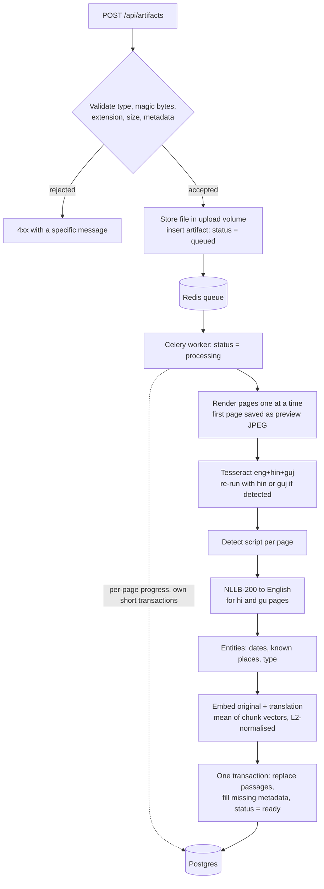
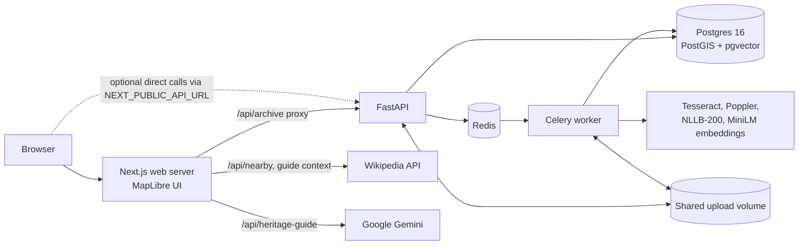

# SthalaSutra

SthalaSutra is a map-aware heritage archive: it turns scans and photographs of heritage records into searchable, translated text that stays linked to the place it describes.

## The problem

Records about a place (field notes, inscriptions, survey sheets, oral-history transcripts) are scattered across English, Hindi, Gujarati and other scripts. Most exist only as scans, so their text cannot be searched, and a reader of one language cannot find a record written in another. The place context is usually lost along the way: a scan in a folder does not know it describes a stepwell 12 km from where you are standing. SthalaSutra keeps the source image, its transcription, an English translation and its location together, and makes all of it searchable by meaning and by distance.

## What it does

- **Ingests** JPEG, PNG, WebP and PDF uploads (up to 25 MB and 100 PDF pages) with optional title, type, era, place, region and coordinates.
- **Reads** each page with Tesseract OCR (English, Hindi, Gujarati), with a second script-specific pass when Hindi or Gujarati is detected.
- **Translates** Hindi and Gujarati pages to English with a local NLLB-200 model; English text is kept as-is.
- **Extracts** dates (including Gujarati and Devanagari digits), known place names and a heritage type from each page, and uses them to fill missing metadata.
- **Indexes** every page as a 384-dimensional multilingual embedding in pgvector, so a query in one script finds records in another.
- **Searches** with a hybrid score (semantic plus literal term match), filters by region, type and era, and an optional radius around a point.
- **Maps** records, routes and folklore pins with PostGIS geometry on a MapLibre map.
- **Shows progress** per page while a file is processed ("Reading page 2 of 5", "Translating page 2 of 5"), plus a preview image of the first page.
- **Answers questions** about a record through an optional heritage guide (Google Gemini) that is restricted to the record's text and a matching Wikipedia article, and lists the sources it used.

The web app (being finalised in parallel with this document) adds "&lt;topic&gt; near &lt;place&gt;" search with place names resolved through Wikipedia, a "Near me" search, filters populated from the data, a source reader with a page switcher that shows the original beside its translation along with extracted entities and a copyable citation, map highlighting of search results, and nearby Wikipedia references.

<!-- screenshots: added after the next live run -->

## A short tour

After `docker compose up --build` and seeding (see [Quick start](#quick-start)), open http://localhost:3000 and try:

| Try | What it shows |
| --- | --- |
| `stepwells near IIT Gandhinagar` | The place is resolved to coordinates through Wikipedia (including redirects), then the archive is searched within a radius of that point. The Adalaj and Dada Harir sample notes lie inside the API's default 25 km radius; Rani ki Vav in Patan does not. |
| `રાણીની વાવ` (Gujarati script) | Cross-lingual search. The multilingual embedding places the Gujarati query close to the Hindi and English Rani ki Vav notes, and the literal term `વાવ` also matches Gujarati text. |
| `Solanki-era temples` | Meaning over keywords: the English Modhera note calls the builder "Chaulukya", the Gujarati Modhera note says સોલંકી, and both are candidates alongside the note that literally says "Solanki-era". |
| Open *Adalaj ni Vav · Gujarati sample field note* | The reader shows the OCR text in Gujarati script beside its machine translation, the extracted date (૧૪૯૯ normalised to 1499) and the detected place. |

A scripted three-minute walkthrough is in [docs/demo.md](docs/demo.md).

## How it works

### Ingestion



Slow model work runs before any passage is written, so a failure leaves the previous passages intact. Errors in the uploaded file (an unreadable PDF, an image over 40 megapixels, no text found) raise `ProcessingError`, whose message is shown to the user. Any other exception is logged and the user sees a generic message. Transient failures are retried up to three times with exponential backoff. A worker child killed mid-task (for example by the out-of-memory killer) is not redelivered; a signal handler marks the record failed instead. Details are in [docs/architecture.md](docs/architecture.md).

### Search ranking

1. The query is embedded with the same multilingual model used for passages.
2. Postgres returns the nearest passages by cosine distance through the HNSW index, after region, type and era filters and, when `lat`/`lon` are given, an `ST_DWithin` radius filter. The candidate pool is `limit × 5` passages, and `hnsw.ef_search` is raised for that transaction so the index does not silently cap it at 40.
3. Each candidate is rescored:

   `score = 0.8 × (1 − cosine_distance) + 0.2 × lexical`

   where `lexical` is the fraction of query terms (three or more characters, minus a short stopword list) that occur as substrings of the original or translated text. Substring matching is deliberate: Hindi and Gujarati vowel signs are not regex word characters, and it lets "stepwell" match "stepwells".
4. Only the best-scoring passage per record is kept, and the top `limit` records are returned with their score, semantic score and distance in kilometres.

## Architecture



The browser talks to the Next.js server, which proxies archive requests to FastAPI using the server-side `HERITAGE_API_URL`. The API and the worker share one database, one queue, one upload volume and one model cache. The web container receives no database credentials.

| Layer | Choice | Why |
| --- | --- | --- |
| Web | Next.js 16, React 19, TypeScript | Server route handlers keep the API address and Gemini key off the client. |
| Map | MapLibre GL with OpenStreetMap raster tiles | Open-source vector map renderer; no map API key needed. |
| API | FastAPI, Pydantic, SQLAlchemy 2 | Typed request validation and response models; OpenAPI docs at `/docs`. |
| Queue | Celery with Redis | OCR and translation take seconds to minutes per page and must not block requests. |
| Database | Postgres 16 with PostGIS and pgvector | Geometry, radius queries and vector search in one transactional store. Runs locally in Compose or on Supabase. |
| OCR | Tesseract (`eng`, `hin`, `guj`), Poppler for PDFs | Runs offline on CPU and ships language packs for all three scripts. |
| Translation | `facebook/nllb-200-distilled-600M` | One model covers Hindi and Gujarati to English and runs on CPU. |
| Embeddings | `sentence-transformers/paraphrase-multilingual-MiniLM-L12-v2` | Small (384 dimensions), multilingual, CPU-friendly; puts queries and passages in different scripts in one space. |
| Guide | Gemini (`gemini-3.5-flash-lite`) through the AI SDK | Optional; a free Google AI Studio key is enough. |

## Quick start

Requirements:

- Docker with Compose v2.
- About 8 GB of memory available to Docker.
- Several GB of free disk for images and the model cache. The first search or ingestion downloads the embedding model; the first Hindi or Gujarati page downloads NLLB-200 (about 2.5 GB). Models are kept in the `modelcache` volume across restarts.

From the repository root:

```bash
cp .env.example .env          # optional; every value has a working default
docker compose up --build
docker compose exec api python -m app.seed   # in a second terminal, once the stack is healthy
```

| URL | What |
| --- | --- |
| http://localhost:3000 | Web app |
| http://localhost:8000/docs | OpenAPI docs for the API |
| http://localhost:8000/ready | Readiness (database and broker) |

The seed queues 11 synthetic sample notes and 4 map features. Re-running it is safe; existing samples are skipped. The cards move from queued to processing to ready as the worker reads them; the first run is slow because the models download.

To enable the heritage guide, create a key in [Google AI Studio](https://aistudio.google.com/apikey), set `GOOGLE_GENERATIVE_AI_API_KEY` in `.env`, and run `docker compose up -d web` to recreate the web container. The free tier has usage limits and Google may use free-tier prompts to improve its services; the guide shows this notice before a question is sent.

To stop: `docker compose down` (add `-v` to delete the database, uploads and model cache).

## Configuration

Compose reads the root `.env` for `${VAR}` interpolation; empty values fall back to the defaults below.

| Variable | Default | Purpose |
| --- | --- | --- |
| `APP_ENV` | `development` | `production` (or `prod`) disables automatic schema creation. |
| `AUTO_CREATE_SCHEMA` | empty (true in development, false in production) | Create tables and extensions at startup. When false, startup checks that migrations are applied and refuses to run otherwise. |
| `DATABASE_URL` | `postgresql+psycopg://heritage:heritage@db:5432/heritage` | Postgres connection URL. `postgres://` and `postgresql://` are rewritten to the psycopg 3 driver. Passed to `api` and `worker` only. |
| `CELERY_BROKER_URL` | `redis://redis:6379/0` | Redis broker for ingestion jobs. |
| `DB_POOL_SIZE` | `5` | SQLAlchemy pool size per process. Use `2` behind the Supabase Session pooler. |
| `DB_MAX_OVERFLOW` | `10` | Extra connections above the pool. Use `0` behind the Supabase Session pooler. |
| `UPLOAD_DIR` | `./uploads` outside Docker; Compose fixes it to `/app/uploads` | Where originals and previews are stored. Must be shared by API and worker. |
| `MAX_UPLOAD_BYTES` | `26214400` (25 MB) | Backend upload limit. Read by `settings.py`; not forwarded by Compose. |
| `CORS_ORIGINS` | `http://localhost:3000` | Comma-separated origins allowed to call the API directly. |
| `HERITAGE_API_URL` | `http://api:8000` | Server-side API address used by the Next.js proxy and the guide. |
| `GOOGLE_GENERATIVE_AI_API_KEY` | empty | Enables the heritage guide. Web container only. |
| `NEXT_PUBLIC_API_URL` | empty | Build-time. When set, the browser calls the API directly instead of through the proxy. |
| `TRANSLATION_MODEL` | `facebook/nllb-200-distilled-600M` | Hugging Face translation model. The code passes NLLB language codes, so a replacement must accept them. |
| `EMBEDDING_MODEL` | `sentence-transformers/paraphrase-multilingual-MiniLM-L12-v2` | Sentence-transformer model. Must output 384 dimensions to match `vector(384)`. |

Compose also sets `SAMPLE_DIR=/app/sample-data` and `HF_HOME=/models/huggingface` for the backend containers.

## API reference

| Method and path | Parameters | Returns |
| --- | --- | --- |
| `GET /health` | | `{"status": "ok"}` (liveness) |
| `GET /ready` | | `{"status": "ready"}`, or 503 if the database or broker is unreachable |
| `POST /api/artifacts` | multipart: `file` (required), `title`, `category` (`stepwell`, `fort`, `craft`, `temple`, `other`; default `other`), `era`, `place_name`, `region`, `latitude`, `longitude` (both or neither) | `ArtifactOut` with `status: "queued"`; 413 over the size limit, 415 on type or signature mismatch, 422 on invalid metadata |
| `GET /api/artifacts` | `region`, `category`, `era`, `limit` (1–200, default 100), `offset` | `ArtifactOut[]`, newest first |
| `GET /api/artifacts/{id}` | | `ArtifactDetailOut`: `ArtifactOut` plus `pages[]` with `page_number`, `original_text`, `translated_text`, `entities {places, dates, category}` |
| `GET /api/facets` | | `{regions, eras, categories}` taken from existing data |
| `GET /api/search` | `q` (2–1000 chars, required), `region`, `category`, `era`, `limit` (1–50, default 20), `lat` and `lon` (both or neither), `radius_km` (1–500, default 25) | `SearchHitOut[]`: `artifact`, best passage `original_text` / `translated_text` / `page_number`, `score`, `semantic_score`, `distance_km` |
| `GET /api/map` | `region`, `category`, `era` | `{artifacts: [{latitude, longitude, artifact}], features: [{id, title, kind, description, geometry (GeoJSON), artifact}]}`; only `ready` records with coordinates |
| `GET /uploads/{file}` | | Stored originals and preview JPEGs |

`region` and `era` filters are case-insensitive substring matches; `category` is exact. `ArtifactOut` contains `id`, `title`, `original_filename`, `media_type`, `category`, `era`, `language`, `status` (`queued`, `processing`, `ready`, `failed`), `progress`, `error_message`, `latitude`, `longitude`, `created_at`, `place {id, name, region}`, first-page `original_text` and `translated_text`, `page_count`, `image_url` and `preview_url`.

Example (values abbreviated):

```http
GET /api/search?q=stepwell&lat=23.2156&lon=72.6842&radius_km=25&limit=2
```

```json
[
  {
    "artifact": {
      "id": "6f1c…",
      "title": "Adalaj Stepwell · Sample field note",
      "category": "stepwell",
      "era": "15th century",
      "language": "en",
      "status": "ready",
      "progress": null,
      "place": {"id": "…", "name": "Adalaj Stepwell", "region": "Gujarat"},
      "page_count": 1,
      "image_url": "/uploads/6f1c….png",
      "preview_url": "/uploads/6f1c….preview.jpg",
      "…": "…"
    },
    "original_text": "Adalaj ni Vav stands north of Ahmedabad. …",
    "translated_text": "Adalaj ni Vav stands north of Ahmedabad. …",
    "page_number": 1,
    "score": 0.61,
    "semantic_score": 0.51,
    "distance_km": 11.7
  }
]
```

The response shape is exact; the numbers are illustrative, not measured.

## Data model

| Table | Key columns |
| --- | --- |
| `places` | `name` (unique), `region`, `geom geometry(Point, 4326)` |
| `artifacts` | `title`, `original_filename`, `storage_path`, `media_type`, `category`, `era`, `language`, `status`, `progress`, `preview_path`, `error_message`, `place_id → places`, `latitude`, `longitude`, `created_at`, `processed_at` |
| `passages` | `artifact_id → artifacts` (cascade delete), `page_number`, `original_text`, `translated_text`, `entities jsonb`, `embedding vector(384)` |
| `map_features` | `title`, `feature_type` (`monument`, `route`, `folklore`), `region`, `description`, `geom geometry(Geometry, 4326)`, `artifact_id → artifacts` |

Indexes: GiST on both geometry columns, HNSW (`vector_cosine_ops`) on `passages.embedding`, B-tree on foreign keys and `artifacts.created_at DESC`. Row-level security is enabled on all four tables. Migrations live in `supabase/migrations/`:

| Migration | Change |
| --- | --- |
| `20261027180025_sthala_archive_schema.sql` | Extensions, `places`, `artifacts`, `passages`, indexes, RLS |
| `20261027180642_add_heritage_map_features.sql` | `map_features` |
| `20261027182827_restrict_archive_data_api_access.sql` | Revokes Data API role grants and default privileges |
| `20261029120000_add_artifact_progress_and_preview.sql` | `artifacts.progress`, `artifacts.preview_path` |

A backend test compiles the SQLAlchemy models to DDL and checks it against these migrations, so local and hosted schemas stay in step.

## Deployment

The intended hosted layout is: the Next.js app on Vercel, the API and worker as long-running containers, Postgres on Supabase and a managed Redis. OCR and model inference do not run in Vercel Functions.

1. **Database.** Apply every file in `supabase/migrations/` in order, for example with `supabase db push` or the SQL editor. The newest migration, `20261029120000_add_artifact_progress_and_preview.sql`, must be applied before the new API is deployed: with `APP_ENV=production` the API checks for `artifacts.progress` and `artifacts.preview_path` at startup and refuses to start without them.
2. **API and worker.** Deploy `backend/Dockerfile` (build context: repository root) twice: once with the default Uvicorn command, once with `celery -A app.worker.celery_app worker --loglevel=INFO --concurrency=1`. Give both `APP_ENV=production`, `DATABASE_URL` (Supabase Session pooler URL with `sslmode=require`), `DB_POOL_SIZE=2`, `DB_MAX_OVERFLOW=0`, `CELERY_BROKER_URL`, `UPLOAD_DIR`, `TRANSLATION_MODEL` and `EMBEDDING_MODEL`. Mount the same persistent volume at `UPLOAD_DIR` on both, and persist `/models` so models are not downloaded on every restart. Keep one worker process per container and scale by adding containers. Use `/health` for liveness and `/ready` for readiness.
3. **Frontend.** Import the repository into Vercel with `frontend/` as the root directory. Set the server-only variables `HERITAGE_API_URL` (the API's HTTPS origin) and, optionally, `GOOGLE_GENERATIVE_AI_API_KEY`.
4. **Upload size.** Vercel Functions accept request bodies up to 4.5 MB, so proxied uploads above that fail even though the backend accepts 25 MB. For larger uploads, set `NEXT_PUBLIC_API_URL` to the API's HTTPS origin (it is baked in at build time) and add the Vercel site origin to the API's `CORS_ORIGINS`.

Never put the database password in a `NEXT_PUBLIC_*` variable or in the frontend project.

## Testing and CI

The backend suite needs no database, broker or ML models: database access is tested by compiling SQL statements, and the model stack (`torch`, `transformers`, `sentence-transformers`) is not installed.

```bash
pip install -r backend/requirements-test.txt
cd backend
python -m pytest
```

It covers upload signature checks and validation errors, the search reranker, filter and geo-radius SQL, schema parity with the migrations, text chunking, script detection, Indic digit normalisation, date, place and type extraction, and preview resizing.

| Workflow | Trigger | Steps |
| --- | --- | --- |
| `.github/workflows/backend.yml` | Push to `main` or pull request touching `backend/`, `ml/`, `supabase/` | Python 3.11, install test requirements, `compileall`, `pytest` |
| `.github/workflows/frontend.yml` | Every push and pull request | Node 20, `npm ci`, `npm run typecheck`, `npm run build` |

## Repository layout

```text
compose.yaml              Local stack: db, redis, api, worker, web
.env.example              Configuration template for the root .env
backend/app/              FastAPI app, models, search reranker, ingestion pipeline, Celery worker, seed
backend/tests/            pytest suite (no models or database needed)
ml/pipeline.py            OCR, language detection, translation, embeddings, entity extraction
infra/db/Dockerfile       Postgres 16 + PostGIS 3.6 + pgvector image
supabase/migrations/      Versioned schema migrations
frontend/                 Next.js app, API proxy, nearby lookup and guide route handlers
data/                     Notes on the generated synthetic samples
docs/                     Architecture notes and demo script
scripts/demo.ps1          Demo steps printed in a terminal
```

## Limitations

- **Sample data is synthetic.** The 11 seeded notes and 4 map features are generated text written for demonstration, labelled as such on the image and in the title. They are not source scans or scholarly transcriptions.
- **OCR quality.** Tesseract works well on clean printed text. Handwriting, palm-leaf manuscripts, faded ink and multi-column layouts will produce poor text. There is no correction interface yet.
- **Translation quality.** NLLB-200 output is a draft. Names, dates and technical vocabulary need human review before citation.
- **CPU latency.** Models run on CPU in the containers. The first request after a start loads the model; translation of a dense page can take tens of seconds. The worker runs one job at a time.
- **Entity extraction is rule-based.** It only recognises places already in the `places` table and a fixed list of type keywords.
- **No authentication.** Anyone who can reach the API can upload. Do not expose it publicly without adding auth.
- **Shared filesystem.** Originals and previews are on a volume shared by API and worker, which limits horizontal scaling.
- **Guide limits.** The guide's rate limit is in memory per web instance (10 questions per 10 minutes per client address), and answers depend on a third-party model.

## Roadmap

- Curator accounts and roles, with an audit trail of edits.
- A review interface for correcting OCR text, translations and entities.
- Object storage (for example Supabase Storage) instead of the shared volume.
- A layout-aware OCR model for handwriting and complex pages.
- A small labelled evaluation set to measure OCR, translation and retrieval quality.

## Data, licences and attribution

- **Map tiles** © OpenStreetMap contributors, served from `tile.openstreetmap.org` under the [OSM tile usage policy](https://operations.osmfoundation.org/policies/tiles/). Heavy production use needs a dedicated tile provider.
- **Wikipedia** article summaries and thumbnails shown as nearby references or used as guide context are from Wikipedia and Wikimedia Commons, licensed CC BY-SA 4.0 (individual images may carry other licences). They are shown with a link to the article and are never stored in the archive.
- **NLLB-200** (`facebook/nllb-200-distilled-600M`) is licensed CC-BY-NC 4.0, which does not permit commercial use. Swap `TRANSLATION_MODEL` for a commercially licensed model before any commercial deployment.
- **Embeddings** use `paraphrase-multilingual-MiniLM-L12-v2` (Apache 2.0). **Tesseract** is Apache 2.0.
- **Sample records** in the seed are synthetic and written for this project; see [data/README.md](data/README.md).
- This repository does not yet include a licence file for its own code.
